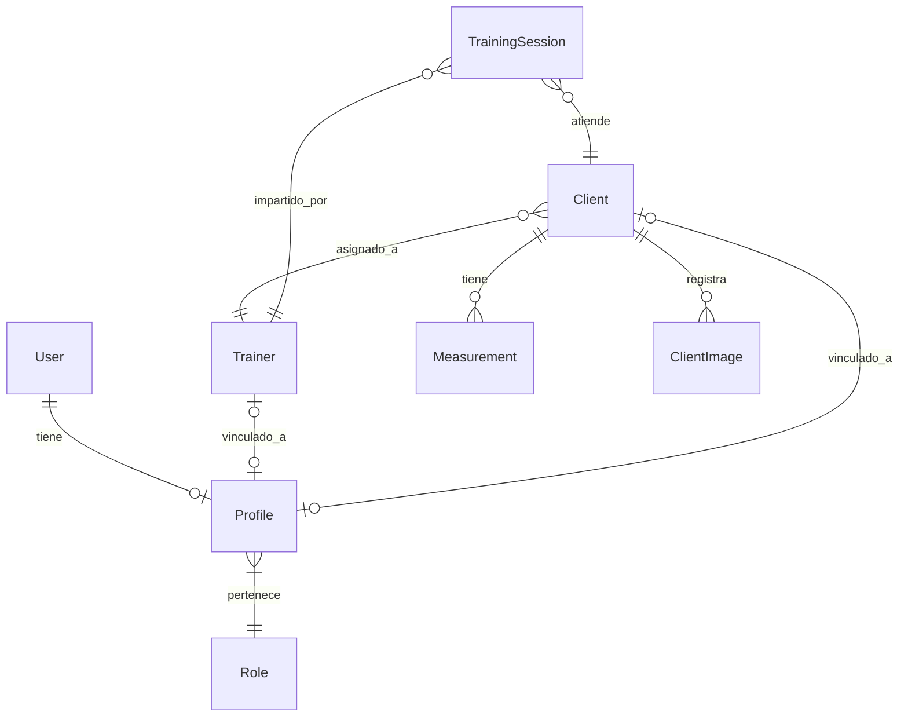

# Estructura y Relaciones de Base de Datos

El sistema de base de datos se divide principalmente en tres grandes módulos definidos en `core/models.py`.

## 1. Módulo de Seguridad y Accesos
Extiende el modelo `User` nativo de Django para manejar perfiles y roles personalizados.
- **Role**: Define el tipo de rol (ej. Admin, Entrenador, Cliente).
- **Profile (Perfil)**: Se enlaza 1 a 1 con el `User` de Django y pertenece a un `Role`.
- **Route (Ruta) & Access (Acceso)**: Modelos para definir rutas de navegación de la app y qué perfiles tienen permisos (Insertar, Actualizar, Borrar) sobre ellas de forma dinámica.

## 2. Entrenadores y Clientes
Es el núcleo del modelo de negocio.
- **Trainer (Entrenador)**: Tiene información de contacto, biografía y foto. Se vincula opcionalmente a un `Profile` para que el entrenador pueda iniciar sesión.
- **Client (Cliente)**: Contiene la información personal, contexto deportivo, objetivos y miedos. Un cliente **tiene un Entrenador asignado** y está vinculado a un `Profile` para su propio acceso.
- **Measurement (Medidas)**: Un cliente tiene múltiples mediciones en el tiempo. El modelo calcula de manera **automática** antes de guardar:
  - IMC y Categoría IMC.
  - Tasa Metabólica Basal (MB) usando la fórmula de Mifflin-St Jeor.
  - Gasto Calórico Total (GCT) basado en el nivel de actividad.
  - También registra el 1RM (Repetición Máxima) en ejercicios clave.
- **ClientImage (Imágenes)**: Permite registrar múltiples fotos de progreso de un cliente a lo largo del tiempo.

## 3. Agenda y Notificaciones
Para el control de las citas y reservas.
- **TrainingSession (Sesión de Entrenamiento)**: Relaciona a un `Cliente` y un `Entrenador` en una `fecha_hora` específica. Tiene estados: Pendiente, Realizado, Cancelado.
- **NotificationLog**: Registro de notificaciones programadas (ej. para avisar 12 horas antes de la sesión).
- **BusinessProfile**: Modelo *Singleton* (diseñado para una sola instancia) para guardar la información general de la empresa (Descripción, perfiles de Instagram y TikTok).

## Diagrama de Relaciones Principal

